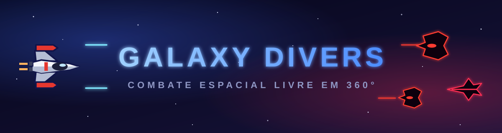
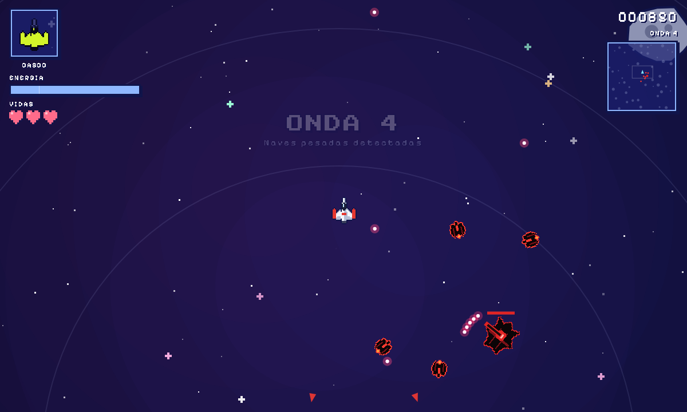
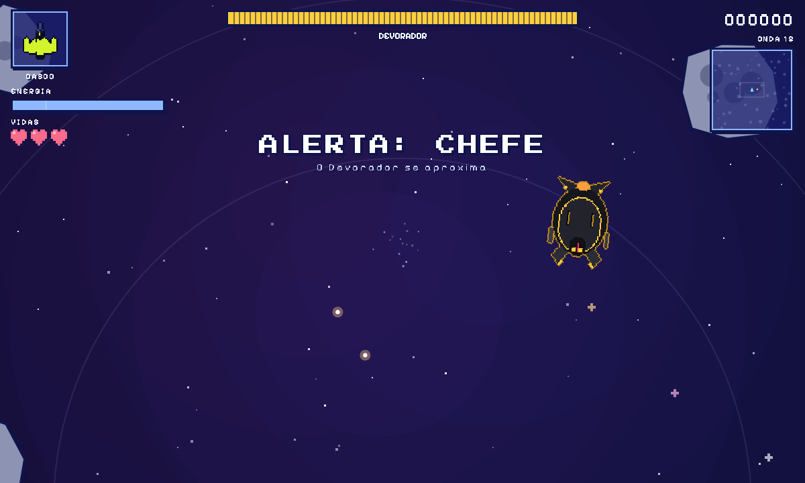
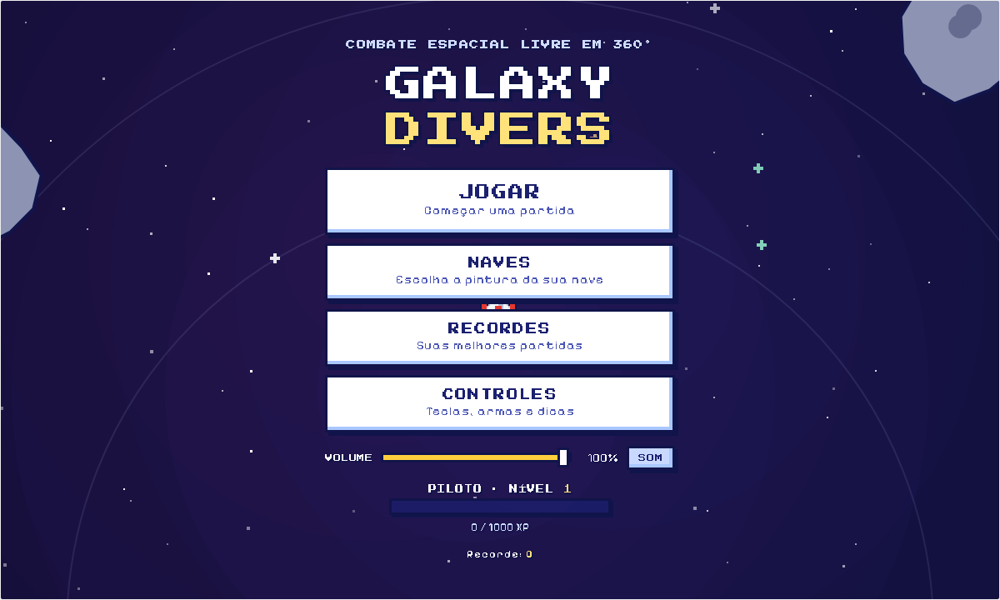
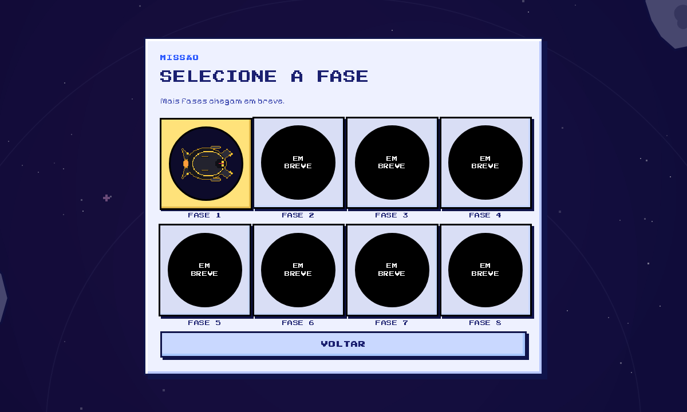
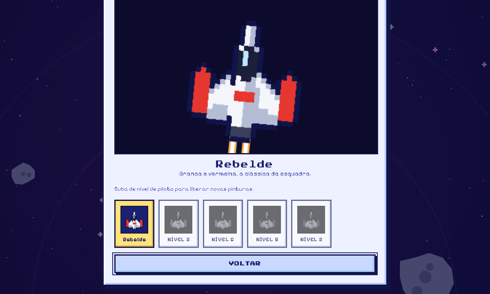
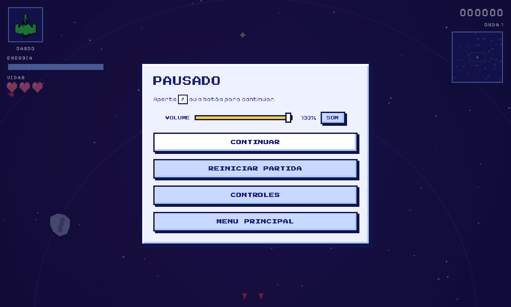
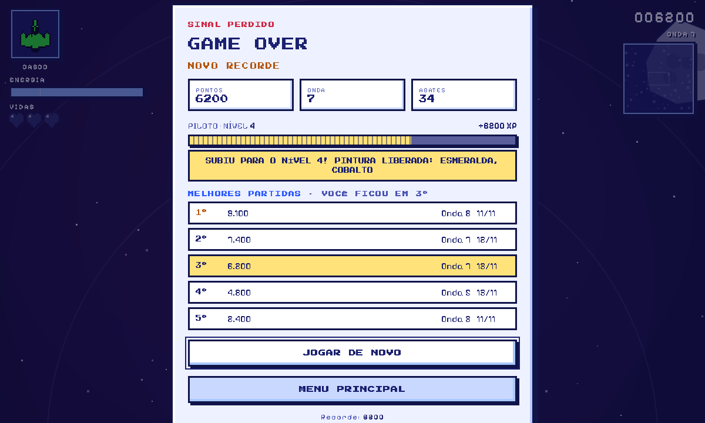
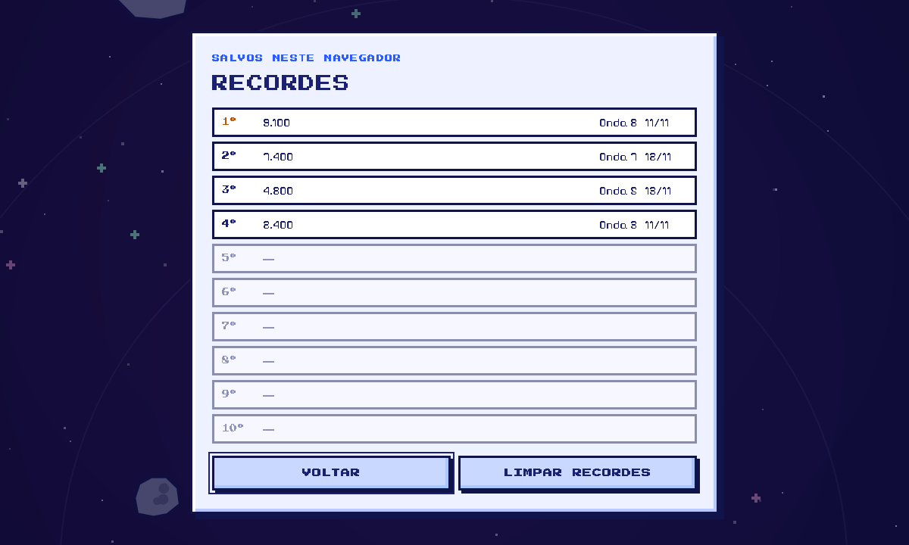
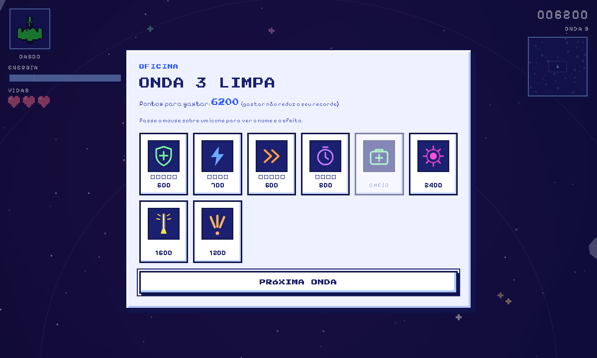

<div align="center">



### Pilote, esquive e destrua esquadrões alienígenas, onda após onda, até enfrentar o chefe.


<a href="https://galaxy-divers.web.app/jogo/"><b>▶ JOGAR NO NAVEGADOR</b></a> &nbsp;·&nbsp; <a href="https://galaxy-divers.web.app"><b>🌐 LANDING PAGE</b></a>

**[▶ Como jogar](#-como-jogar)** · **[🏠 Menu](#-menu-principal)** · **[🎮 Controles](#-controles)** · **[🏅 Vidas e progresso](#-vidas-recordes-e-nível-de-piloto)** · **[🛠 Oficina](#-oficina-de-melhorias)** · **[👾 Inimigos](#-inimigos)** · **[👑 Chefe](#-chefe-o-devorador)**

</div>

---

## 🚀 O jogo

**Galaxy Divers** é um jogo de combate espacial em visão de cima, em **pixel art**, com **movimento livre em 360°** e inércia de verdade. Você pilota uma nave branca e vermelha contra ondas cada vez maiores de naves alienígenas vermelhas e pretas, usa asteroides a seu favor e gasta seus pontos numa **Oficina** entre as ondas para ficar mais forte. Você tem **3 vidas**, e na **onda 15** um chefe entra em cena.

Tudo roda no navegador, em **um único arquivo HTML**, sem instalar nada, no computador ou no celular.

<div align="center">




</div>

## 🏠 Menu principal

Ao abrir o jogo você cai no menu principal, com quatro opções:

| Botão | O que faz |
|---|---|
| **Jogar** | Abre a **seleção de fases**: são 8 vagas, mas por enquanto só a **Fase 1** está disponível (as outras aparecem como "Em breve") |
| **Naves** | Abre o **Hangar**: escolha a pintura da sua nave, com uma prévia animada. As pinturas são liberadas conforme o seu [nível de piloto](#-vidas-recordes-e-nível-de-piloto). A escolha fica salva no navegador |
| **Recordes** | Mostra as 10 melhores partidas salvas neste navegador |
| **Controles** | Mostra as teclas, as armas especiais e as dicas de voo, e permite **trocar as teclas** do jogo |

O menu também tem o seu **nível de piloto** (com a barra de XP) e o controle de **volume**. Durante o jogo, a tela de pausa e a de Game Over têm um botão **Menu principal** para voltar. `Esc` volta de qualquer submenu.

<div align="center">





</div>

## ✨ Destaques

- 🎯 **Mira livre com o mouse** e movimento por WASD, para fugir para um lado e atirar para o outro.
- 🌀 **Manobra lateral com giro**: deixa a nave invulnerável por um instante. Esquivar de um tiro de raspão dá bônus.
- 🔥 **Boost** que gasta energia, para escapar ou fechar a distância.
- ☄️ **Asteroides perigosos**: batem em você, mas também nos inimigos. Atraia perseguidores para as rochas.
- ❤️ **3 vidas**, com renascimento protegido, e tela de **Game Over** com recordes.
- 🏆 **Tabela de recordes locais** e **nível de piloto** que libera novas pinturas.
- 🛠 **Oficina entre as ondas**: melhore casco, motores, energia e recarga, e compre armas especiais.
- 💥 **Três armas especiais** com recargas independentes, trocadas pelo scroll do mouse.
- 👾 **Inimigos com comportamentos diferentes**, incluindo uma investida que só se evita no tempo certo.
- 👑 **Chefe na onda 15**, com barra de vida, fúria e reforços.
- 🎨 **Hangar de naves** com cinco pinturas e prévia animada.
- ⌨️ **Teclas personalizáveis**, também dentro do jogo, pelo menu de pausa.
- 🔊 **Volume ajustável** e botão de mudo, no menu e na pausa.
- 📱 **Controles de toque** para celular, com joystick, botões e pausa.
- 🔊 **Efeitos sonoros sintetizados** em tempo real (sem arquivos de áudio).

## ▶ Como jogar

**Opção 0: jogar online, sem baixar nada**

- ▶ [Jogar no navegador](https://galaxy-divers.web.app/jogo/), no computador ou no celular.
- 🌐 [Landing page do jogo](https://galaxy-divers.web.app), com as telas, as regras e os controles.

**Opção 1: baixar e abrir**

1. Baixe o arquivo [`space-dodger.html`](space-dodger.html) (botão **Raw** > salvar como, ou clone o repositório).
2. Dê dois cliques nele. Pronto, abre no navegador.

**Opção 2: clonar**

```bash
git clone https://github.com/nicolasmoreira284/Galaxy_Divers.git
cd Galaxy_Divers
```

Depois abra o `space-dodger.html` no seu navegador (Chrome, Edge, Firefox ou Safari).

> 💡 Jogue em tela cheia (`F11`) e com um mouse para ter a melhor experiência. O jogo carrega as fontes pixeladas da internet; sem conexão ele usa uma fonte comum no lugar.

## 🎮 Controles

As teclas abaixo são as **padrão**. Em **Controles**, no menu principal ou na pausa, clique em uma ação e aperte a nova tecla para trocá-la. Se a tecla já estiver em uso, as duas ações trocam de lugar. Há também o botão **Restaurar padrão**.

| Tecla / Mouse | Ação |
|---|---|
| `W` `A` `S` `D` (ou setas) | Mover a nave (cima, esquerda, baixo, direita) |
| **Mouse** | Mirar. A nave sempre aponta para a mira |
| **Botão esquerdo** (ou `R`) | Atirar |
| `C` | Manobra lateral com giro (esquiva) |
| `Shift` | Boost, enquanto se move |
| **Botão direito** (ou `F`) | Usar a arma especial selecionada |
| **Scroll** (ou `Q` `E`) | Trocar de arma especial |
| `1` `2` `3` | Escolher a Esfera de Plasma, o Laser ou a Rajada Tripla |
| `P` ou `Esc` | Pausar e continuar |
| `M` | Ligar / desligar o som |

`P`, `M`, `Esc` e `1` `2` `3` são reservadas e não podem ser atribuídas a outras ações.

**No celular**, os controles aparecem na tela: joystick à esquerda para pilotar e, à direita, os botões FOGO, BOOST, as manobras laterais (ESQ e DIR), ESPECIAL e TROCAR. O botão **II**, no topo, pausa o jogo, e o aparelho vibra quando você leva dano. Jogue com o celular **na horizontal**: ao iniciar a partida o jogo entra em tela cheia (quando o navegador permite), a visão se afasta para mostrar mais do mapa e o HUD e os menus ficam compactos.

### Pausa e volume

A pausa tem os botões **Continuar**, **Reiniciar partida**, **Controles** e **Menu principal**, além do controle de **volume** (0 a 100%) com um botão **SOM / MUDO**. O volume e o mudo ficam salvos no navegador.

<div align="center">



</div>

## 🏅 Vidas, recordes e nível de piloto

### Vidas e Game Over
Você começa com **3 vidas**, mostradas como corações no canto da tela. Ao perder o casco, a nave **renasce com o casco e a energia cheios** e fica protegida por alguns segundos, e os tiros inimigos próximos somem. Quando as vidas acabam, a partida termina na tela de **Game Over**, que mostra pontos, onda, abates, o XP ganho e as suas melhores partidas, com os botões **Jogar de novo** e **Menu principal**.

### Recordes locais
As **10 melhores partidas** (pontos, onda e data) ficam salvas no navegador. Veja a lista em **Recordes**, no menu, ou nas 5 primeiras no Game Over, onde a sua posição aparece destacada. O botão **Limpar recordes** apaga tudo, depois de uma confirmação.

<div align="center">




</div>

### Nível de piloto
Cada partida rende **XP igual aos pontos** que você fez, e o XP é acumulado entre as partidas (também salvo no navegador). O **nível 2** pede 1.000 XP e cada nível seguinte pede 500 XP a mais que o anterior, até o **nível 30**. A cada nível novo você libera pinturas da nave no Hangar:

| Pintura | Nível necessário |
|---|---|
| Rebelde (branca e vermelha) | 1 |
| Cobalto | 2 |
| Esmeralda | 3 |
| Solar | 5 |
| Fantasma | 8 |

## 💣 Armas especiais

As três são compradas na Oficina. Cada uma tem **recarga própria**, que continua contando mesmo quando você troca de arma. Só o ícone da arma selecionada aparece no canto da tela.

| Arma | O que faz | Recarga |
|---|---|---|
| 🟣 **Esfera de Plasma** | Segure para carregar e solte. A esfera explode em área, **destrói asteroides** e os destroços ferem os inimigos | 14 s |
| 🟡 **Laser** | Feixe rápido de 1 s com pouco dano, que **atordoa** os inimigos atingidos por 1,5 s | 12 s |
| 🟠 **Rajada Tripla** | Três tiros pesados de uma vez, em leque | 9 s |

## 🛠 Oficina de melhorias

Ao limpar uma onda, o jogo abre a Oficina. Passe o mouse sobre cada ícone para ver o nome e o efeito (no celular, toque uma vez para ver e outra para comprar). Gastar pontos **não reduz o seu recorde nem o seu XP**.

<div align="center">



</div>

| Ícone | Item | Efeito | Preço | Níveis |
|---|---|---|---|---|
| 🛡 | **Casco reforçado** | +25 de vida máxima e repara 25 | 600, +500 a cada nível | 5 |
| ⚡ | **Eficiência de energia** | −12% no gasto de manobras e boost | 700, +600 a cada nível | 4 |
| ⏩ | **Motores** | +8% de velocidade e aceleração | 600, +500 a cada nível | 5 |
| ⏱ | **Recarga especial** | −10% no tempo de recarga das armas especiais | 800, +700 a cada nível | 4 |
| 🧰 | **Reparo de emergência** | Restaura metade do casco | 400 | sempre |
| 🟣 | **Esfera de Plasma** | Desbloqueia a arma | 2400 | única |
| 🟡 | **Laser** | Desbloqueia a arma | 1600 | única |
| 🟠 | **Rajada Tripla** | Desbloqueia a arma | 1200 | única |

O ícone do casco é a silhueta da sua nave e muda de **verde para amarelo e para vermelho** conforme você perde vida.

## 👾 Inimigos

Vermelhos e pretos, com visual de naves alienígenas em pixel art. Ficam brancos ao levar dano e amarelos quando atordoados.

| Nave | Comportamento |
|---|---|
| **Caça** | Circula você e atira. Parte deles desvia dos asteroides |
| **Interceptador** | Rápido e frágil. De tempos em tempos **avisa, trava a mira e investe com tudo**. Dá para escapar saindo da linha ou usando a manobra lateral na hora certa (+150 pontos) |
| **Pesada** | Lenta e resistente, dispara rajadas em leque com uma torre que acompanha você |

## 👑 Chefe: o Devorador

Na **onda 15** o jogo avisa "ALERTA: CHEFE" e o Devorador entra: uma canhoneira negra com acabamento dourado, garras na frente e uma máscara de olhos dourados. A vida dele aparece numa barra no topo da tela.

| Fase | Comportamento |
|---|---|
| **Normal** | Mantém distância e circula você. Atira leques de 3 tiros e, a cada poucos segundos, solta um **anel de projéteis** que dá para atravessar pelas brechas ou esquivar com a manobra lateral |
| **Fúria** (abaixo de 50% da vida) | Atira leques de 5 tiros mais rápidos, solta anéis mais densos e chama **dois interceptadores** de reforço de tempos em tempos |

- Tem **220 de vida** e é **imune ao atordoamento** do laser.
- Encostar nele causa muito dano.
- Derrotá-lo vale **5.000 pontos** e deixa um item de casco. Depois o jogo segue para a Oficina e as ondas continuam.

## 🧠 Dicas de piloto

- Use a manobra lateral **no instante em que o tiro ou a investida chega**. Esquivar de raspão dá pontos extras.
- **Leve os inimigos para os asteroides.** Quem bate numa rocha toma dano, e o interceptador explode.
- Derrubar inimigos em sequência aumenta o **combo** (até x5).
- O **laser** não mata rápido, mas deixa o inimigo parado: ótimo para se reposicionar ou para acertar a Esfera de Plasma.
- Guarde pontos para a **Esfera de Plasma**: ela limpa grupos e rochas de uma vez.
- Depois de perder uma vida, aproveite a proteção do renascimento para se afastar dos inimigos.
- Contra o chefe, **chegue à onda 15 com a Oficina em dia**: casco, recarga especial e uma arma especial comprada fazem diferença. Fique em movimento e atravesse os anéis pelas brechas.

## 🧩 Detalhes técnicos

- HTML5 `<canvas>` e JavaScript puro, **sem bibliotecas nem build**.
- Áudio gerado em tempo real com a Web Audio API.
- As naves, os inimigos e o chefe são **sprites em pixel art gerados por código** (um pequeno rasterizador de formas, sem imagens externas). Os ícones da Oficina são SVG.
- Fontes pixeladas (Press Start 2P e Pixelify Sans) carregadas do Google Fonts.
- Tudo o que é salvo fica no `localStorage` do navegador: recordes, nível de piloto (XP), pintura da nave, teclas e volume.
- `scripts/capturar-telas.js` refaz as capturas de tela do jogo usadas neste README (precisa do Chrome ou do Edge).

---

<div align="center">

Feito com 🚀 e muito café espacial. Boa sorte, piloto!

</div>
