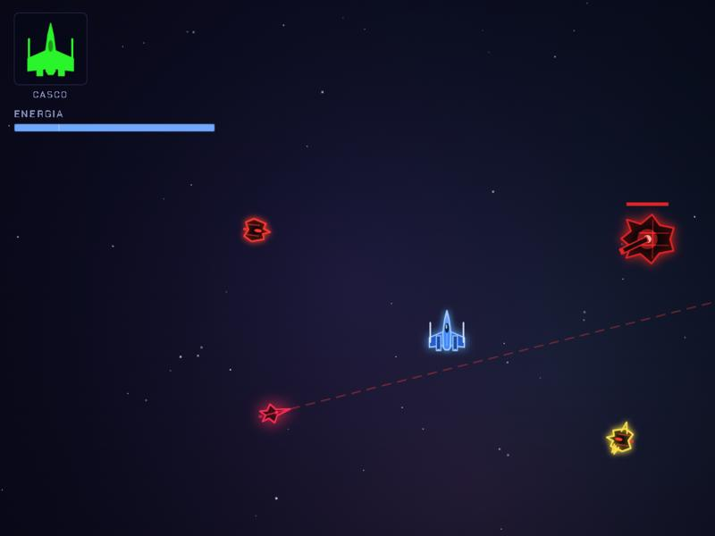
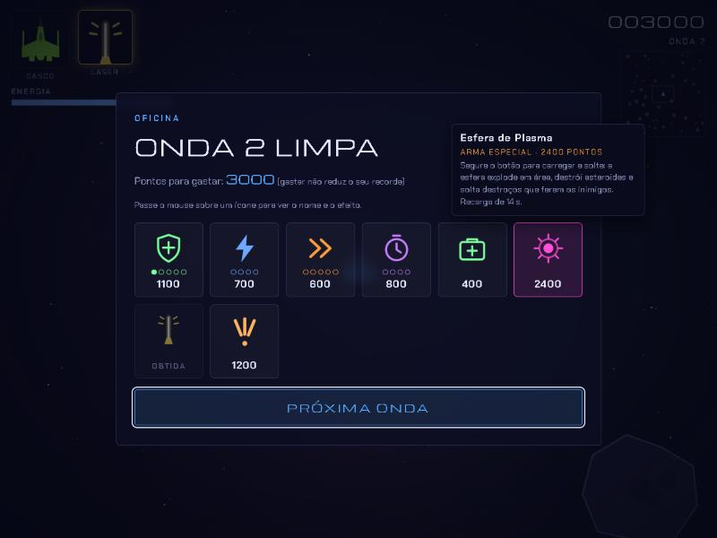

<div align="center">


### Pilote, esquive e destrua esquadrões alienígenas, onda após onda.


**[▶ Como jogar](#-como-jogar)** · **[🎮 Controles](#-controles)** · **[🛠 Oficina](#-oficina-de-melhorias)** · **[👾 Inimigos](#-inimigos)**

</div>

---

## 🚀 O jogo

**Space Dodger** é um jogo de combate espacial em visão de cima, com **movimento livre em 360°**, inércia de verdade e uma nave azul inspirada nos caças da rebelião. Você enfrenta ondas cada vez maiores de naves alienígenas vermelhas e pretas, usa asteroides a seu favor e gasta seus pontos numa **Oficina** entre as ondas para ficar mais forte.

Tudo roda no navegador, em **um único arquivo HTML**, sem instalar nada.

<div align="center">




</div>

## ✨ Destaques

- 🎯 **Mira livre com o mouse** e movimento por WASD, para fugir para um lado e atirar para o outro.
- 🌀 **Manobra lateral com giro** (`C`): deixa a nave invulnerável por um instante. Esquivar de um tiro de raspão dá bônus.
- 🔥 **Boost** que gasta energia, para escapar ou fechar a distância.
- ☄️ **Asteroides perigosos**: batem em você, mas também nos inimigos. Atraia perseguidores para as rochas.
- 🛠 **Oficina entre as ondas**: melhore casco, motores, energia e recarga, e compre armas especiais.
- 💥 **Três armas especiais** com recargas independentes, trocadas pelo scroll do mouse.
- 👾 **Inimigos com comportamentos diferentes**, incluindo uma investida que só se evita no tempo certo.
- 🔊 **Efeitos sonoros sintetizados** em tempo real (sem arquivos de áudio) e **recorde salvo** no navegador.

## ▶ Como jogar

**Opção 1: baixar e abrir**

1. Baixe o arquivo [`space-dodger.html`](space-dodger.html) (botão **Raw** > salvar como, ou clone o repositório).
2. Dê dois cliques nele. Pronto, abre no navegador.

**Opção 2: clonar**

```bash
git clone https://github.com/nicolasmoreira284/Space-Dodger.git
cd Space-Dodger
```

Depois abra o `space-dodger.html` no seu navegador (Chrome, Edge, Firefox ou Safari).

> 💡 Jogue em tela cheia (`F11`) e com um mouse para ter a melhor experiência.

## 🎮 Controles

| Tecla / Mouse | Ação |
|---|---|
| `W` `A` `S` `D` | Mover a nave (cima, esquerda, baixo, direita) |
| **Mouse** | Mirar. A nave sempre aponta para a mira |
| **Botão esquerdo** (ou `R`) | Atirar |
| `C` | Manobra lateral com giro (esquiva) |
| `Shift` | Boost, enquanto se move |
| **Botão direito** (ou `F`) | Usar a arma especial selecionada |
| **Scroll** (ou `Q` `E`, `1` `2` `3`) | Trocar de arma especial |
| `P` | Pausar |
| `M` | Ligar / desligar o som |

No celular há controles na tela (joystick, fogo, boost, manobras e especial).

## 💣 Armas especiais

As três são compradas na Oficina. Cada uma tem **recarga própria**, que continua contando mesmo quando você troca de arma. Só o ícone da arma selecionada aparece no canto da tela.

| Arma | O que faz | Recarga |
|---|---|---|
| 🟣 **Esfera de Plasma** | Segure para carregar e solte. A esfera explode em área, **destrói asteroides** e os destroços ferem os inimigos | 14 s |
| 🟡 **Laser** | Feixe rápido de 1 s com pouco dano, que **atordoa** os inimigos atingidos por 1,5 s | 12 s |
| 🟠 **Rajada Tripla** | Três tiros pesados de uma vez, em leque | 9 s |

## 🛠 Oficina de melhorias

Ao limpar uma onda, o jogo abre a Oficina. Passe o mouse sobre cada ícone para ver o nome e o efeito. Gastar pontos **não reduz o seu recorde**.

| Ícone | Item | Efeito | Níveis |
|---|---|---|---|
| 🛡 | **Casco reforçado** | +25 de vida máxima e repara 25 | 5 |
| ⚡ | **Eficiência de energia** | −12% no gasto de manobras e boost | 4 |
| ⏩ | **Motores** | +8% de velocidade e aceleração | 5 |
| ⏱ | **Recarga especial** | −10% no tempo de recarga das armas especiais | 4 |
| 🧰 | **Reparo de emergência** | Restaura metade do casco | sempre |
| 🟣🟡🟠 | **Armas especiais** | Esfera de Plasma, Laser e Rajada Tripla | única |

O ícone do casco muda de **verde para amarelo e para vermelho** conforme você perde vida.

## 👾 Inimigos

Todos vermelhos e pretos, com visual de naves alienígenas.

| Nave | Comportamento |
|---|---|
| **Caça** | Circula você e atira. Parte deles desvia dos asteroides |
| **Interceptador** | Rápido e frágil. De tempos em tempos **avisa, trava a mira e investe com tudo**. Dá para escapar saindo da linha ou usando a manobra `C` na hora certa (+150 pontos) |
| **Pesada** | Lenta e resistente, dispara rajadas em leque com uma torre que acompanha você |

## 🧠 Dicas de piloto

- Use a manobra `C` **no instante em que o tiro ou a investida chega**. Esquivar de raspão dá pontos extras.
- **Leve os inimigos para os asteroides.** Quem bate numa rocha toma dano, e o interceptador explode.
- Derrubar inimigos em sequência aumenta o **combo** (até x5).
- O **laser** não mata rápido, mas deixa o inimigo parado: ótimo para se reposicionar ou para acertar a Esfera de Plasma.
- Guarde pontos para a **Esfera de Plasma**: ela limpa grupos e rochas de uma vez.

## 🧩 Detalhes técnicos

- HTML5 `<canvas>` e JavaScript puro, **sem bibliotecas nem build**.
- Áudio gerado em tempo real com a Web Audio API.
- Ícones e a nave desenhados em código (SVG e Canvas), sem imagens externas.
- Recorde guardado no `localStorage` do navegador.

---

<div align="center">

Feito com 🚀 e muito café espacial. Boa sorte, piloto!

</div>
